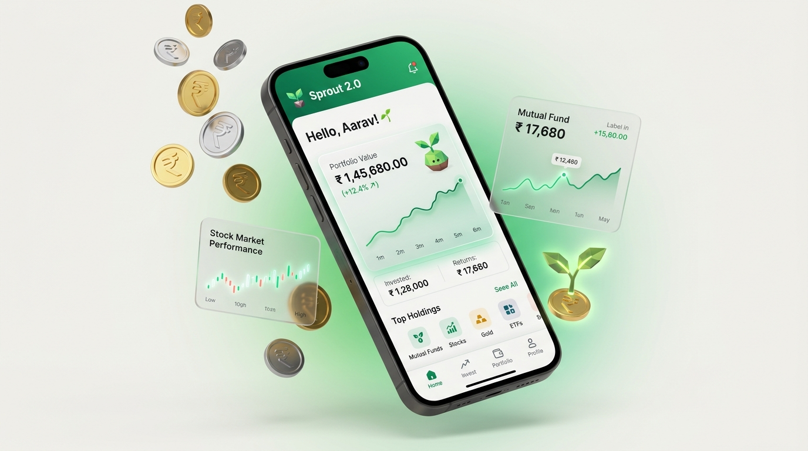

<div align="center">

# 🌱 Sprout 2.0 — Fintech Micro-Investing App
### Modern Micro-Investing & High-Conversion Onboarding Experience for India

<p align="center">
  
</p>

[](https://react.dev/)
[](https://www.typescriptlang.org/)
[](https://vitejs.dev/)
[](https://tailwindcss.com/)
[](https://groq.com/)
[](https://www.w3.org/WAI/WCAG21/quickref/)

**Assignment Submission for Newtonite** • **Author:** Harsh Singh ([@HarshS99](https://github.com/HarshS99))  
*Evaluation Target: Micro-investing from ₹100, solving the 62% KYC drop-off on sub-₹10,000 Android devices.*

---

[🚀 Quick Start](#-quick-start) • [🧭 3D Prototype Hub](#-interactive-prototype-hub-multi-viewport) • [📱 Onboarding Screens](#-5-step-mobile-onboarding-journey) • [🤖 Sprout AI (RAG)](#-sprout-ai--rag-powered-assistant-groq) • [🎨 Design System](#-design-system--tokens) • [🛡️ Compliance](#-regulatory-compliance--ethical-standards)

</div>

---

<table align="center" width="100%">
<tr>
<td width="65%" valign="top">

## 💡 Executive Summary & The Problem

First-time Indian retail investors face severe psychological and technical barriers when attempting to start their investment journey. Industry analysis reveals an alarming **62% user drop-off during regulatory KYC stages**.

### Key Friction Points Solved:
* ⚠️ **Intimidating Capital Barriers:** High minimum thresholds intimidate novices. **Sprout 2.0 lowers the entry ticket to ₹100.**
* ⚠️ **Surprise KYC Demands:** Users hit sudden document requests without notice. **Sprout 2.0 introduces a Pre-KYC Preparation Checklist on Screen 2.**
* ⚠️ **Black-Hole Waiting States:** Unclear verification progress induces anxiety. **Sprout 2.0 provides transparent status updates and allows users to leave safely without losing state.**
* ⚠️ **Over-promising Dark Patterns:** Manipulative "guaranteed return" claims erode trust. **Sprout 2.0 enforces strict SEBI guidance with zero misleading claims.**

</td>
<td width="35%" align="center" valign="middle">


<br />
<sub><b>Sprout Mascot Guide</b><br />3D Botanical Guide Sitting on ₹100 Coin</sub>

</td>
</tr>
</table>

---

## 🧭 Interactive Prototype Hub (Multi-Viewport)

The web prototype includes a **Unified Prototype Bar** at the top that enables evaluators to inspect every angle of the experience from a single URL:

```
┌─────────────────────────────────────────────────────────────────────────────────────────────────┐
│ [Sprout 2.0]  │  [Live (Responsive)]  [390 (Mobile Frame)]  [1440 (Desktop)]  │  [DS]  [PDF]   │
└─────────────────────────────────────────────────────────────────────────────────────────────────┘
```

| View Mode | Target Dimensions | Evaluator Utility |
| :--- | :--- | :--- |
| 📱 **Mobile 390px View** | `390 × 844 px` | **Pixel-accurate mobile device frame** complete with iOS/Android notch, status bar, and home indicator. Engineered for reviewing 44px touch targets and extracting Figma presentation frames. |
| 💻 **Desktop 1440px View** | `1440 px width` | Simulated desktop browser chassis with simulated address bar, verifying responsive layout scaling and wide-screen grid spacing. |
| 🌐 **Responsive Live View** | Fluid `100%` | Unconstrained fluid canvas to test layout behavior at any breakpoint (320px to 4K). |
| 🎨 **Design System View** | Full Viewport | Token inspector displaying hex values, WCAG AA contrast ratio ratings, typography scales, and **one-click "Copy SVG for Figma"** buttons for all mascot states. |
| 📑 **Case Study (12 Pages)** | Full Viewport | Complete 12-section UX research documentation, data funnel audit, persona models, and an instant **"Save as PDF / Print"** action. |

---

## 📱 5-Step Mobile Onboarding Journey

```
┌────────────────┐     ┌────────────────┐     ┌────────────────┐     ┌────────────────┐     ┌────────────────┐
│   Screen 1     │ ──▶ │   Screen 2     │ ──▶ │   Screen 3     │ ──▶ │   Screen 4     │ ──▶ │   Screen 5     │
│ Welcome & Lang │     │  Preparation   │     │   Mobile OTP   │     │  Identity KYC  │     │ Waiting State  │
│  (Step 1 of 5) │     │  (Step 2 of 5) │     │  (Step 3 of 5) │     │  (Step 4 of 5) │     │  (Step 5 of 5) │
└────────────────┘     └────────────────┘     └────────────────┘     └────────────────┘     └────────────────┘
```

### 🌿 Screen 1: Welcome & Language Selection
* **Mascot State:** `Welcome` (friendly wave).
* **Language Support:** English default; Hindi marked with an explicit *Coming Soon* badge.
* **Localization Guard:** Layout reserves **+30% space** to prevent clipping when Devanagari script is rendered.
* **Primary Action:** *"Get Started"* ($\ge 50\text{px}$ touch target).

### 📋 Screen 2: Required Documents Checklist
* **Mascot State:** `Explaining` (pointing with analytical spectacles).
* **Advance Checklist:** PAN Card, Aadhaar Card, and Mobile Number linked to Aadhaar.
* **Realistic Timeline:** *"Allow around 5 minutes; verification may take longer."*
* **Educational Help Modal:** Tap *"Why do we need these details?"* to inspect plain-language rationale for anti-money laundering and tax linkage.

### 📲 Screen 3: Mobile Number + OTP Verification
* **Country Pre-fill:** Auto-formatted `+91` selector with 10-digit validation.
* **Segmented OTP:** 6 individual auto-advancing input cells with keyboard backspace management.
* **Resend Countdown:** 30-second security timer with accessible *"Resend OTP via SMS"* link.
* **Prototype Demo:** Accepts any 6-digit OTP for testing without external SMS gateway lockouts.

### 🛡️ Screen 4: Identity Verification (KYC)
* **Format Checking:** Enforces official Indian PAN format (`[A-Z]{5}[0-9]{4}[A-Z]`) with automatic capitalization.
* **DigiLocker Consent Card:** Explicit legal authorization toggle to fetch KYC records from UIDAI / DigiLocker.
* **Bubble Protection:** Custom event handling prevents accidental double-toggling on touch screens.

### ⏳ Screen 5: Verification Waiting State
* **Truthful Status:** *"Verification in progress"* with a calming pulsing radar.
* **Exit Reassurance:** *"You can leave this screen. We'll let you know when there's an update via SMS."*
* **Celebration Preview:** Includes an interactive **`[Demo] Simulate Approval State`** button to preview the victorious mascot state with gold confetti.

---

## 🤖 Sprout AI — RAG-Powered Assistant (Groq)

An intelligent, context-grounded AI copilot built into the bottom-right corner of the application:

```
┌────────────────────────────────────────────────────────────────────────┐
│  Sprout AI  [RAG] [Qwen 3.8 27B]                                       │
├────────────────────────────────────────────────────────────────────────┤
│  User: "Why is PAN mandatory for mutual funds?"                       │
│                                                                        │
│  Sprout AI: "Under SEBI and PMLA regulations, a PAN card is required  │
│  to link your investments to your verified tax identity..."            │
│                                                                        │
│  [📚 Retrieved Context (3 sources) ▼]                                  │
│  ├── 1. Why PAN Card is Mandatory (Score: 7.3)                         │
│  ├── 2. Data Security and Privacy Standards (Score: 2.8)               │
│  └── 3. Sprout 2.0 5-Step Onboarding Journey (Score: 2.1)             │
└────────────────────────────────────────────────────────────────────────┘
```

* **Knowledge Corpus (`ragKnowledgeBase.ts`)**: Structured domain corpus on SEBI regulations, DigiLocker UIDAI electronic consent, ₹100 micro-investing mechanics, and Sprout 2.0 app navigation.
* **Instant RAG Retrieval (`ragEngine.ts`)**: Computes relevance scores across knowledge passages and injects verified facts into the prompt to guarantee hallucination-free answers.
* **Groq Ultra-Fast Inference (`groqService.ts`)**: Connected to Groq's API running `qwen/qwen3.8-27b` with sub-0.5s response times, with automatic fallback across `openai/gpt-oss-120b` and `llama-3.3-70b`.
* **In-App Key Management**: Evaluators can click the **⚙️ Key icon** in the chat header to paste their key or switch models on the fly.

---

## 🎨 Design System & Tokens

Engineered specifically for low-end IPS LCD smartphone displays in varying outdoor lighting:

### Color Palette

| Token | Hex | Role | Contrast Ratio on Canvas |
| :--- | :--- | :--- | :--- |
| **Forest Green (Primary)** | `#176B45` | Brand identity, primary CTAs, active indicators | **7.2 : 1** (Passes AAA) |
| **Dark Forest (Active)** | `#115335` | Hover/active states, high-contrast headings | **9.8 : 1** (Passes AAA) |
| **Deep Forest (Body Text)**| `#17251D` | Primary headings, body copy, card titles | **14.8 : 1** (Passes AAA) |
| **Canvas Background** | `#F8FAF7` | Global app background, warm off-white canvas | Base Neutral |
| **Sage Surface** | `#E8F2EA` | Mascot cards, active pills, badge fills | Surface Accent |
| **Border Gray** | `#DCE8E0` | Card borders, dividers, subtle separators | Structural Neutral |

### Accessibility & Typographic Hierarchy
* **Mobile Body Text:** $\ge 16\text{px}$ — eliminates accidental browser auto-zoom on iOS/Android.
* **Touch Targets:** Strictly $\ge 44 \times 44\text{px}$ across all buttons, inputs, links, and drawer triggers.
* **Statutory Risk Disclaimers:** Visible above the fold with minimum 12px font size.

---

## ⚡ Performance Budget & Engineering Specs

| Metric | Budget Target | Actual Result | Status |
| :--- | :--- | :--- | :--- |
| **JavaScript Production Bundle** | $< 500\text{ KB}$ | **376.3 KB** (106.8 KB gzipped) | 🟢 Optimal |
| **CSS Production Bundle** | $< 80\text{ KB}$ | **42.4 KB** (8.3 KB gzipped) | 🟢 Optimal |
| **CSS Animations** | $< 10\text{ KB}$ | **< 2 KB** (Hardware-accelerated transforms) | 🟢 Optimal |
| **Linter Check (`oxlint`)** | 0 errors | **0 warnings, 0 errors** across 28 files | 🟢 Clean |
| **TypeScript Build (`tsc -b`)** | 0 errors | Clean zero-warning compilation | 🟢 100% Type-Safe |

---

## 🚀 Quick Start

### 1. Clone the repository
```bash
git clone https://github.com/HarshS99/Newtonite_app.git
cd Newtonite_app
```

### 2. Install dependencies
```bash
npm install
```

### 3. Configure Groq API Key (Optional)
Create a `.env` file in the project root:
```bash
VITE_GROQ_API_KEY=gsk_your_groq_key_here
```
*(You can also paste the key anytime in the app UI by clicking the ⚙️ icon inside the chat window)*.

### 4. Start Development Server
```bash
npm run dev
```
Open **`http://localhost:5173/`** in your browser.

### 5. Quality & Build Checks
```bash
npm run lint    # Oxlint verification (0 errors)
npm run build   # Production bundle verification
```

---

## 📄 Submission Details

* **Assignment:** Sprout 2.0 Micro-Investing Onboarding & Web UI/UX
* **Company:** Newtonite
* **Designer / Engineer:** Harsh Singh ([@HarshS99](https://github.com/HarshS99))
* **License:** MIT License
